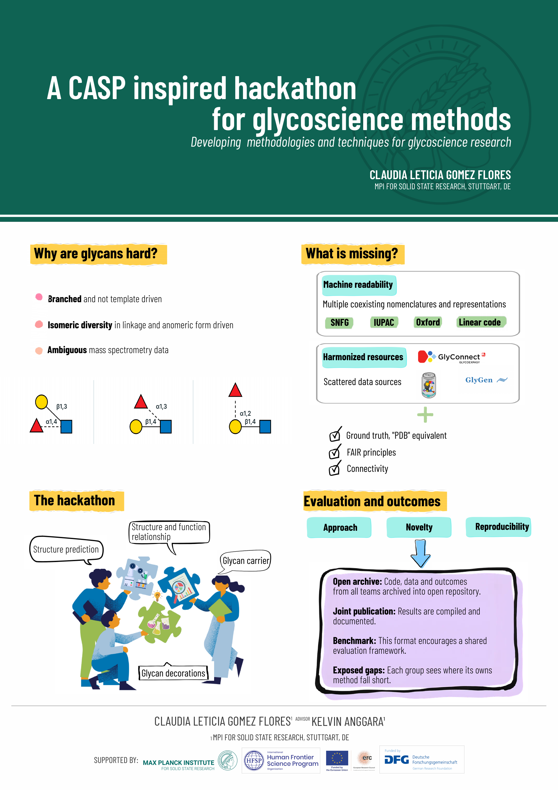

# Glycothon

A CASP inspired hackathon for glycoscience methods.

Status: draft proposal. Date and venue to be announced.

[Download the poster as PDF (A0)](assets/hackathon_poster.pdf)

## Scope

Glycothon focuses on developing methodologies and techniques for glycoscience. It is not a basic glycoscience research competition.

## 1. Why glycans are hard

Glycans are branched molecules that are not template driven. Linkage, anomeric configuration and branching produce isomeric diversity and a combinatorial complexity beyond what current methods handle for proteins or nucleic acids.

As post translational modifications, glycans are not directly genome encoded, so approaches built for sequence based biomolecules do not transfer. Mass spectrometry, still the dominant technique, often cannot resolve linkage and branching, which leaves datasets with inherent structural ambiguity.

## 2. What is still missing

Both bioinformatics and experimental science have advanced glycan characterization, from single molecule glycan sequencing to motif annotation, structure prediction from LC-MS/MS data and protein glycan interaction modeling. These advances remain scattered.

1. Resources are not harmonized. GlyTouCan, GlyGen, UniCarbKB and GlyConnect coexist without full integration.
2. Nomenclatures compete. IUPAC condensed, Oxford, SNFG and linear code hinder machine readability.
3. There is no ground truth. Protein science relies on the PDB, glycoscience has no equivalent benchmark corpus.
4. There is no shared evaluation framework comparable to the CASP GDT score.

## 3. The hackathon

Computational and experimental glycoscientists meet on one shared, hands on space. Participants form mixed teams that combine different labs and backgrounds. Each team defines and pursues a specific challenge, for example:

1. Structure prediction
2. Matching glycan and carrier
3. Structure function relationships
4. Biological function of glycan decorations

The goal is to expose each group's gaps and exchange ideas toward common standards.

## 4. Evaluation and outcomes

A judging panel evaluates submissions on approach, novelty and reproducibility.

Panel: Marissa Maciej (invited, to be confirmed), others to be confirmed.

Code, data and outcomes from all teams are archived in a public repository. Results are compiled toward a joint publication documenting the exercise. The format encourages benchmarking, cross disciplinary exchange and lasting collaboration.

## Get involved

Contact: [CONTACT EMAIL]
Sign up: [LINK TO SIGN UP FORM]

## Organizers

Claudia Leticia Gomez Flores, MPI for Solid State Research, Stuttgart, DE
Advisor: Kelvin Anggara, MPI for Solid State Research, Stuttgart, DE

## Repository layout

index.html, style.css and the assets folder hold the project website. Enable GitHub Pages on the main branch, root folder, to publish it.
